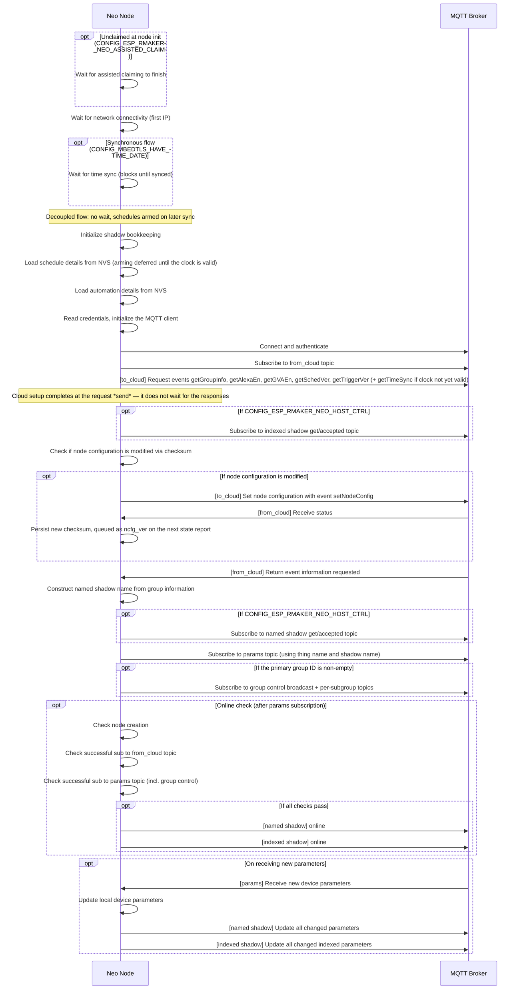

# Initialization and Startup Sequence

## Component Initialization Order

The node initialization follows a specific order with dependencies. All steps run inside `esp_rmaker_node_init()`:

1.  **Connectivity trapdoor**: Arm the network-status trapdoor before the network can come up, so the start task can gate MQTT on connectivity
2.  **Event Loop**: Initialize event loop for inter-component communication
3.  **NVS (Non-Volatile Storage)**: Initialize NVS for persistent storage
4.  **Local Configuration**: Initialize local configuration management
5.  **Factory partition**: Open the factory partition that holds the credentials
6.  **Challenge-response**: Register the `ch_resp` provisioning endpoint (see [Network Provisioning](provisioning.md))
7.  **Assisted claiming**: Only when `CONFIG_ESP_RMAKER_NEO_ASSISTED_CLAIM` is set and the node has no certificate: generate the key pair and register the `rmaker_claim` provisioning endpoint
8.  **Checksum**: Initialize the checksum store (node configuration and node tag change detection)
9.  **Time Synchronization**: Initialize SNTP, only if `enable_time_sync` is set in the configuration (see [Time Synchronization](time_sync.md))
10. **Scheduler**: Initialize the timer/scheduler backend
11. **Network Common**: Initialize network abstraction layer
12. **State Change Management**: Initialize state change tracking and reporting
13. **Cloud Manager**: Initialize cloud event management
14. **Notification Manager**: Initialize notification publishing
15. **Timeseries Manager**: Initialize timeseries data collection
16. **Work Queue**: Initialize work queue for asynchronous tasks
17. **Bridge subsystem**: Only when `CONFIG_ESP_RMAKER_NEO_BRIDGE_ENABLE` is set
18. **MQTT implementation**: Select the MQTT implementation (wrapped by the budgeting shim when `CONFIG_ESP_RMAKER_NEO_MQTT_ENABLE_BUDGETING` is set). The credential read and the client initialization happen in the start task
19. **Services**: Initialize the schedule and automation services
20. **Start task**: Queue the start task as the first work-queue task, then post the "init done" event

`esp_rmaker_node_init()` does not read the cloud credentials, so it succeeds on an unclaimed node. Everything from the claim wait onwards happens in the start task, on the work queue — `esp_rmaker_node_init()` itself does not block on provisioning or on the network.

The start task runs these steps in order:

1.  **Assisted claiming**: Wait for the claim to finish, only if the node was unclaimed at node init. The claim runs over the provisioning session, so it does not need the network
2.  **Network**: Block on the connectivity trapdoor until the first IP is acquired (no-op on POSIX)
3.  **Time synchronization**: Wait for the clock in the synchronous flow only (see [Time Synchronization](time_sync.md))
4.  **Shadows and services**: Initialize the shadow bookkeeping, load the schedule and automation state from NVS
5.  **MQTT**: Run the MQTT host migration check (only with `CONFIG_ESP_RMAKER_NEO_MQTT_HOST_MIGRATION`), build the connection parameters from the credentials store, initialize the client and log the init summary
6.  **Local endpoints**: Start the local control and challenge-response endpoint sets the application enabled before this step
7.  **Connect**: Start the MQTT host migration timeout (only with `CONFIG_ESP_RMAKER_NEO_MQTT_HOST_MIGRATION`), connect to the MQTT broker and continue with the cloud setup

### Local Only Build

A node that never reaches the cloud (for example a BLE session only build) is built with `CONFIG_ESP_RMAKER_NEO_LOCAL_ONLY`. The examples select it from `CONFIG_APP_NETWORK_BLE_MODE_SESSION_ONLY` (see `examples/common/app_network/Kconfig.projbuild`). Node init then sets up no MQTT implementation, starts no time synchronization and creates no schedule or automation service, so the linker drops the MQTT client and the TLS libraries. The state report APIs return `ESP_RMAKER_OK` and queue or send nothing. Assisted claiming, bridge, host control and MQTT budgeting are not selectable. `esp_rmaker_ota_enable()` only runs the INIT rollback check, marks a passed image valid and returns `ESP_RMAKER_NOT_SUPPORTED`.

A separate start task runs only step 6 (local endpoints) and posts `RMAKER_EVENT_CORE_STARTED`. A separate stop task only stops the work queue.

## Prerequisites

### Before Network Provisioning

- NVS must be initialized
- `esp_rmaker_node_init()` must have completed: it registers the provisioning endpoints

### Before MQTT Connection

- Network provisioning must be complete
- Assisted claiming must have written the credentials, if the node was unclaimed (the start task blocks on it)
- Network connection must be established (the start task blocks on the connectivity trapdoor until the first IP is acquired; no-op on POSIX). With `CONFIG_ESP_RMAKER_NEO_MQTT_HOST_MIGRATION`, the start task then starts the target host connection timeout
- Time synchronization must complete **in the synchronous flow only** (`CONFIG_MBEDTLS_HAVE_TIME_DATE`); the decoupled flow does not wait
- Shadow bookkeeping must be initialized
- Service data must be loaded from NVS (schedules, automation triggers)

### Before Cloud Communication

- MQTT connection must be established
- Cloud manager must be initialized
- Subscriptions to `from_cloud` topic must complete

On the first MQTT connection the SDK queues the cloud-setup task and (with `CONFIG_ESP_RMAKER_NEO_HOST_CTRL`) the indexed-shadow subscribe task on the work queue, in that order. Because the work queue is serial, the indexed-shadow subscribe runs only after the whole cloud-setup task has finished, and the `setNodeConfig` drain — kicked from the end of cloud setup — is queued behind both. Cloud setup ends once the `get*` bundle has been *published*; it does not block on the responses, so the named-shadow and params subscriptions (driven by the `getGroupInfo` response) may land after `setNodeConfig`.

## Failure Points

### Initialization Failures

- **NVS Failure**: Prevents local configuration access; may require factory reset
- **Network Failure**: Prevents MQTT connection; node remains in provisioning or error state
- **Time Sync Failure**: In the synchronous flow (`CONFIG_MBEDTLS_HAVE_TIME_DATE`) startup blocks until sync (a valid clock is required for the TLS handshake); in the decoupled flow startup never blocks. See [Time Synchronization](time_sync.md)
- **MQTT Host Migration Failure**: With `CONFIG_ESP_RMAKER_NEO_MQTT_HOST_MIGRATION`, a node with no stored node ID and no certificate CN aborts the start task and leaves the SDK in the error state
- **MQTT Connection Failure**: Prevents cloud communication; triggers reconnection attempts
- **Claim Failure**: An unclaimed node that was provisioned without claiming, or whose claim did not complete, has no credentials; the start task aborts and leaves the SDK in the error state
- **Credential Failure**: A failed credential read or MQTT client initialization aborts the start task and leaves the SDK in the error state
- **Shadow Initialization Failure**: Aborts the start task and leaves the SDK in the error state
- **Service Data Load Failure**: A failure to load schedule or automation details from NVS aborts the start task and leaves the SDK in the error state

### Startup Failure Handling

- **Init Failures**: Any failure inside `esp_rmaker_node_init()` tears down everything already initialized and returns an error — there is no partially initialized SDK
- **Start-Task Failures**: A failure in the start task leaves the SDK in the error state; nothing is torn down and no restart is triggered by the SDK
- **Non-Critical Failures**: Logged but do not prevent node operation (for example, a failed subscription is handed to a retry context)

## Relationship to Network Provisioning

- **Before Provisioning**: `esp_rmaker_node_init()` registers the `ch_resp` endpoint and, on an unclaimed node, the `rmaker_claim` endpoint
- **During Provisioning**: Network provisioning service runs; the application calls `esp_rmaker_start()` once the network is started
- **After Provisioning**: The start task waits for claiming, reads the credentials and connects

## Overall Firmware Flow

- Services have their own operation flows:
  - [Schedules](services/builtin.md#operation)
  - [Automation](services/builtin.md#operation-1)
